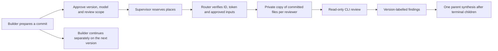

# Repository readers alongside a builder

`repository_readonly_v1` lets a reviewer explore all regular tracked files of an
approved Git commit. It complements `text_only_review_v1`, which only receives
selected text. Neither replaces the other. A review always identifies its commit;
it does not attest the builder's current working tree or a subsequent commit.

The production baseline stays capacity **1**, reader profiles **disabled**. This
contract does not authorize inference, account use, spend or deployment. Native
approval is required for creation and queuing; concurrency additionally requires
the [rollout prerequisites](async-rollout.md).



## Ownership of the contract

- **Tasks/MCP** store the approved model, provider, profile, access declaration
  and canonical versioned inputs. A draft never queues itself. Material edits
  withdraw approval; revisions need fresh review inputs.
- **State/supervisor** retain the common claim, capacity, provenance, recovery,
  cancellation and synthesis rules. No schema migration is added.
- **Router** composes and validates inputs, creates private snapshots, inspects
  the CLI and builds provider-specific commands. Both run and stream use this
  boundary before interactive history, continuity or JIT context loading.
- **The CLI** performs the actual review with its installed authentication.
  Solar does not call a model API directly or add a billing account. CLI account
  limits and billing mode still need explicit operator validation.

The builder can be an interactive author outside the async pool. Async tasks
with write access remain exclusive under the existing scheduler. This change
allows multiple approved readers; it does not add concurrent async writers or
promise quota reserved for the interactive builder.

## Version and snapshot boundary

Prepare an existing full 40/64-character commit object ID, not HEAD, a branch or
a tag. The repository must be its physical root. Router reads Git objects without
checkout, hooks, replace objects, global/system Git configuration, or lazy fetch.
The full manifest covers repository, commit/tree, exact model/provider/prompts,
file paths, modes represented by the accepted tree entries, object IDs, SHA-256
content hashes and sizes. File execution bits are deliberately not reproduced.

The initial bound is 10,000 regular files and 32 MiB total. Symlinks, submodules,
unsafe paths, root CLI configuration directories and tracked credential-like
files are rejected, not silently omitted. There are no filters or repository
setup scripts. Choose another reviewed commit if it contains unsupported files.

At execution Router revalidates approved inputs, materializes all files into a
private temporary directory without `.git`, rechecks the ID/token and snapshot,
and invokes the selected CLI there. Each invocation receives an independent
copy of the same version. Uncommitted builder edits and newer commits do not
change it. The source repository is never given as the review cwd. A result is
labelled `Reviewed commit: <full ID>` by Solar, not inferred from model prose.

The copy is checked for unexpected files, symlinks and changed content after
execution, and removed in `finally`. A mismatch invalidates the result. This is
defense in depth, not the mechanism that prevents writes. The CLI restrictions
below prevent writes; a writable temporary copy alone is not a sandbox.

This is a repository review, not a general machine read-isolation guarantee.
The CLI's OS/runtime/authentication reads still exist. Do not use this profile
as an attestation that no file outside the snapshot can be read, or that a
review result proves absence of hidden provider-side context. Hostile repository
instructions remain untrusted evidence, even when the CLI discovers them.

## Provider implementations and stop conditions

| Provider | Implemented boundary | Status |
|---|---|---|
| Claude | Existing help/managed-policy preflight; safe/restricted modes, empty setting sources, only `Read,Glob,Grep`, plan permissions, empty strict MCP and disabled hooks; exact model and fixed system prompt | Implemented; real quality pilot still required |
| Codex | Private config home with only a mode-0600 copy of the CLI auth file, `exec --sandbox read-only`, approval policy `never`, ignored user config/rules, ephemeral JSONL output, explicit empty integration registries and disabled hooks/plugins/apps/agent/browser/computer/image-generation and skill-install/discovery features | Implemented; effective-config preflight and real sandbox evidence required |
| Cursor `agent` | Installed help advertises `--mode plan/ask` and sandbox, but no equivalent empty configuration/integration boundary was established | Candidate; rejected without fallback |
| Agy | Installed help advertises `--mode plan` and terminal sandbox, but no equivalent empty configuration/integration boundary was established | Candidate; rejected without fallback |

CLI configuration overrides and extra execution flags are refused. Account
credentials are never put in manifests, prompts or captured results. Codex
currently requires file-backed CLI auth; the private copy is deleted with its
config home. Its auth mechanism may refresh the private credential copy; it is
not copied back to the original. Keyring-only authentication is unsupported in
this initial adapter. Review account/token lifecycle before production use.

Codex preflight uses `exec --help` and the same config overrides in `doctor
--json`. Its effective config must include cloud-policy inspection, zero MCP
servers, none of the prohibited features, approval policy `Never`, and no
managed filesystem source. Missing/changed diagnostic fields or unreadable
policy refuse launch. Overall network diagnostics may fail without changing
these specific config checks; model access is not inferred from doctor output.
Never weaken this parser to turn an unsupported host into success.

The inspected local CLI versions were Codex 0.162.1 and Claude Code 2.1.285.
The [Codex configuration reference](https://developers.openai.com/codex/config-reference)
and [managed configuration](https://developers.openai.com/codex/enterprise/managed-configuration)
explain why sandbox selection alone is insufficient for hooks/MCP. Help and
synthetic tests establish command compatibility, not real model review quality.
Claude exposes file readers only; Codex can use its sandboxed shell. The prompt
forbids executing project code, but this is not a separate OS execution ban.

## Native task preparation

`task.create` and `task.update` accept a closed `review` object. Router composes
the canonical manifest; arbitrary commands, environment or flags cannot be
supplied. Explicit provider and instructions are required with every new review.
For an update, also pass the stored `task_id` and `expected_row_version`.

```json
{
  "operation": "task.create",
  "arguments": {
    "title": "Review committed implementation",
    "instructions": "Identify correctness regressions and cite affected files.",
    "provider": "codex",
    "review": {
      "profile": "repository_readonly_v1",
      "model": "EXACT_APPROVED_MODEL_ID",
      "repository": "/absolute/approved/repository",
      "commit": "FULL_APPROVED_COMMIT_OBJECT_ID",
      "rules": ["Separate findings from uncertainty."]
    }
  }
}
```

Default access is read-only for that repository. An explicit access declaration
must be read-only and contain that root. Review creation returns a draft and row
version. Inspect and use ordinary `task.approve` for that exact stored version.
The native confirmation shows profile, model, repository and commit both when
preparing and when approving. Changing provider/model/version/inputs is a
material edit; a queued task returns to draft. No profile is globally enabled by
creating or approving a task: it runs exclusively while profiles are disabled.

Existing packet reviews can use the same entry point with `profile:
text_only_review_v1`, exact model and `evidence` entries containing `source_path`,
`content` and raw-byte `sha256`. Repository fields and packet evidence cannot be
mixed. Packet composition and its no-tools provider restrictions are unchanged.

## One builder and bounded derived reviews

A parent task may instead supply `review_batch` with one repository/commit and
one to five explicit reviews. Every item names a unique key/title, exact
instructions, provider, model and optional rules. The parent must name
`object`, `scope` and `effect`. MCP creates the approved catalog and bounded
subtask policy; the child access is read-only on that repository. The parent
keeps its own access policy and ordinary execution mode.

```json
"review_batch": {
  "repository": "/absolute/approved/repository",
  "commit": "FULL_APPROVED_COMMIT_OBJECT_ID",
  "reviews": [
    {"key":"correctness", "title":"Correctness review", "instructions":"Find correctness bugs.", "provider":"codex", "model":"EXACT_MODEL_ID"},
    {"key":"regressions", "title":"Regression review", "instructions":"Find regressions.", "provider":"claude", "model":"EXACT_MODEL_ID"},
    {"key":"tests", "title":"Test review", "instructions":"Find test coverage gaps.", "provider":"codex", "model":"EXACT_MODEL_ID"}
  ]
}
```

The worker supplies the exact approved declarations to the parent's prompt.
The parent requests them through its existing `<subtasks>` response. State
materializes the complete batch atomically/idempotently with derived child
approvals. No model can select a different commit, add a reviewer or broaden its
scope. Children use the common pool; the parent waits and synthesizes once.
Revocation, cancellation, missing dependencies and uncertain synthesis keep their
existing stop conditions.

## Verification and rollout

Tests use disposable Git repos, runtimes and provider doubles. Integrated tests
apply policy through native operations in the test runtime, release three/five
same-provider workers through a durable-event barrier, assert overlap, one
synthesis and no duplicate dispatch. They do not establish account headroom.

The separate inference-free Codex sandbox probe is opt-in:

```sh
SOLAR_TEST_REPOSITORY_CLI=1 python3 core/tests/support/repository_review_cli_probe.py
```

It uses a temporary config home without credentials, invokes no model, checks
reads succeed and writes fail both inside and outside the cwd, checks original
bytes, and removes its temporary directory. Run on macOS/Linux with a compatible
CLI. A skipped probe is not evidence. This complements constructor diagnostics;
it does not simulate a whole model invocation or attest Claude's behavior.

Before enabling this profile, obtain the real useful-review pilot, versioned CLI
policy evidence, account limits and bounded observation, then propose capacity
3 and later 5 through the existing runbook. Include `repository_readonly_v1`
explicitly in `enabled_reader_profiles` only after that separate authorization.
Keep `text_only_review_v1` available for fixed evidence evaluations. Capacity 1
with profiles disabled remains the default and the safe operational rollback.
